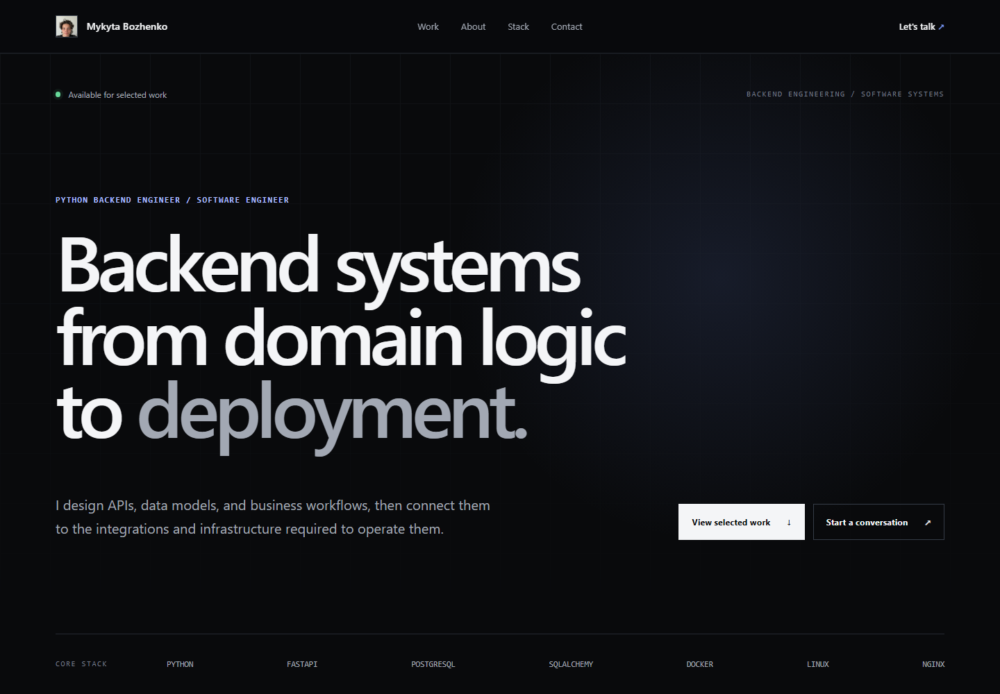

# Mykyta Bozhenko — Engineering Portfolio

[](https://github.com/pipinovi4/mykyta-portfolio/actions/workflows/ci.yml)

The source for [mykytabozhenko.site](https://mykytabozhenko.site), my personal portfolio as a Python backend and software engineer. The site presents selected application, systems, and infrastructure work through concise, evidence-based case studies.



## What this repository demonstrates

- A statically rendered portfolio built with the Next.js App Router, React, strict TypeScript, and Tailwind CSS
- Typed project content kept separate from reusable UI components
- Responsive layouts, semantic HTML, keyboard-accessible controls, and reduced-motion support
- Per-project metadata, canonical URLs, and optimized local images
- A multi-stage, non-root Docker image with health checks and a minimal runtime
- GitHub Actions quality gates, GHCR image publishing, and health-checked deployment to a Linux VPS

This repository intentionally contains no application backend, database, CMS, or contact-form service. It is a focused presentation layer; the backend and systems work is documented in the linked project repositories and case studies.

## Selected work

| Project | Focus | Evidence |
| --- | --- | --- |
| FinControl | FastAPI, PostgreSQL, role-based workflows, Telegram, RabbitMQ, object storage | Private product; the portfolio uses a sanitized implementation review and a real interface capture |
| [BackpropLab](https://github.com/pipinovi4/backprop-lab-cpp) | C++17 tensors, explicit gradients, optimizers, and experimental Transformer components | Public source, tests, examples, and documented limitations |
| [Cloudflare Edge Guard](https://github.com/pipinovi4/cloudflare-edge-guard) | Defensive Bash automation for Nginx and UFW behind Cloudflare | Public source and 19 Bats tests, verified 2026-09-04 |
| [Ubuntu VPS Bootstrap](https://github.com/pipinovi4/ubuntu-vps-bootstrap) | Guarded Ubuntu provisioning and Docker Compose deployment | Public source and 16 Bats tests, verified 2026-09-04 |

Claims on the site are limited to behavior visible in the source, documentation, or reproducible checks. Private customer data, credentials, traffic figures, and unverifiable business outcomes are deliberately excluded.

## Architecture

```text
Typed profile and case-study content
                │
                ▼
Next.js Server Components ── client components for gallery and visual effects
                │
                ▼
        Standalone Next.js server
                │
                ▼
  Docker container on 127.0.0.1:8080
                │
                ▼
   Host Nginx and Cloudflare (production)
```

The public routes are statically generated. `/health` is a lightweight route used by Docker Compose and the deployment smoke test. Production reverse-proxy and TLS configuration are host-managed and intentionally not duplicated in this repository.

## Repository structure

```text
.
├── .github/workflows/ci.yml    # quality, image publishing, and deployment
├── docs/                       # content/design notes and recording guide
├── frontend/
│   ├── public/                 # CV, portrait, and verified project media
│   ├── src/app/                # App Router pages and health endpoint
│   ├── src/components/         # reusable presentation components
│   └── src/content/            # typed profile and case-study content
├── docker-compose.dev.yml      # local container workflow
└── docker-compose.yml          # production frontend service
```

## Local development

Prerequisites:

- Node.js 24, matching [`.nvmrc`](.nvmrc)
- npm

```bash
nvm use
cd frontend
npm ci
npm run dev
```

Open `http://localhost:3000`.

The canonical site URL is optional for local development because the production URL is the default. To override it locally:

```bash
cp ../.env.example .env.local
```

`NEXT_PUBLIC_SITE_URL` supplies the canonical origin. The application contains no secrets.

## Quality checks

Run the same application checks used by CI:

```bash
cd frontend
npm run lint
npm run typecheck
npm run build
```

For containerized development:

```bash
docker compose -f docker-compose.dev.yml up --build
```

The development service is available on port `3000`. The production Compose file binds the standalone server to `127.0.0.1:8080` so that the host reverse proxy remains the only public entry point.

## Delivery

Pull requests and pushes to `main` run linting, TypeScript checks, a production build, and a Docker build. A successful push to `main` publishes commit-addressed images to GitHub Container Registry, updates the Compose service over SSH, waits for container health, and checks `/health`.

Deployment requires repository environment secrets for the SSH key, host, and pinned `known_hosts` entry. Host provisioning, Nginx, Cloudflare, TLS certificates, backups, and rollback remain operational concerns outside this frontend repository.

## Content updates

Portfolio data lives in:

- [`frontend/src/content/portfolio.ts`](frontend/src/content/portfolio.ts)
- [`frontend/src/content/case-studies.ts`](frontend/src/content/case-studies.ts)

Use real screenshots, repository links, and reproducible technical facts. If evidence cannot be published, state that limitation directly instead of substituting mock media or invented metrics.

## License

Source code is available under the [MIT License](LICENSE). The CV, portrait, and project screenshots are personal portfolio content and are not granted for reuse as third-party identity or marketing assets.
